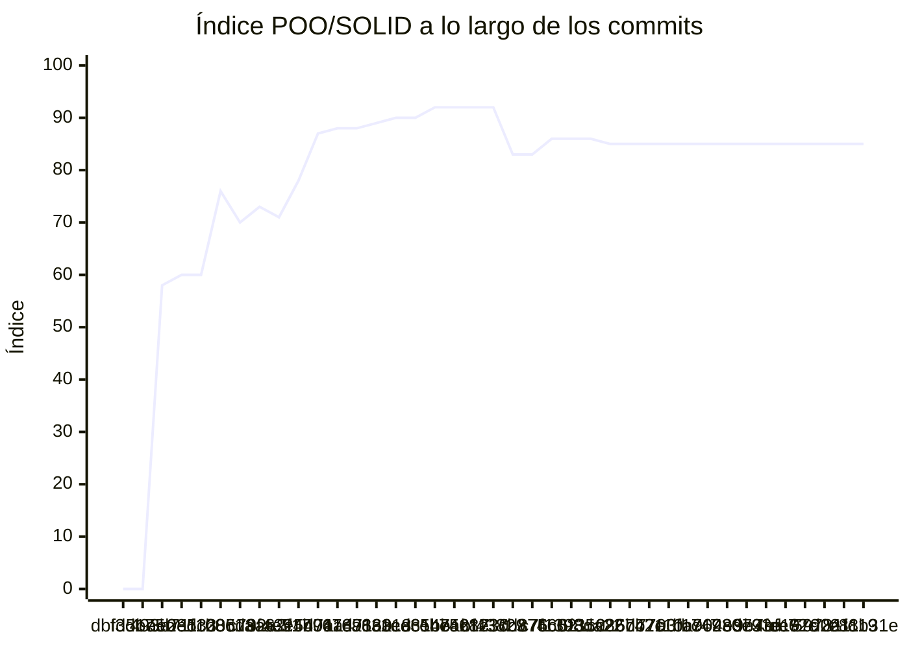

<!-- evaluacion:inicio -->
# Evaluación — nacho-baldasso-organizacion/Proyecto-Submarino-Prime

> Documento **generado automáticamente** por la cátedra de Programación II (RepoSense + análisis de calidad POO/SOLID). **No editar a mano**: se regenera en cada evaluación.
> Rama evaluada: `main`. Análisis **heurístico** (regex + métricas): es una criba para orientar la revisión, **no una nota**.
> Generado: 2026-11-20.

## 1. Veredicto

| Aspecto | Resultado |
|---|---|
| Índice de calidad POO/SOLID | **85/100** |
| Código (LOC) | 14,144 |
| Archivos de código | 192 |
| Clases (bien usadas) | 332 (218 OK) |
| Código dentro de clases (%POO) | 99% |
| Funciones fuera de clases | 0 |
| Duplicación lógica | 3.0% |
| Señales S/O/L/I/D | 19/0/0/2/14 |

> Este informe **describe** lo que el análisis midió con los criterios ya establecidos de la materia. No es una nota.

### Semáforo de aprobación

Criterios de `CRITERIOS-CALIDAD.md`. **Aprobar** se juega con el perfil `estandar`; **destacar**, con el `exigente` (meta de excelencia).

| Semáforo | Resultado |
|---|---|
| Aprobar (`estandar`) | **no cumple** — 3/4 |
| Destacar (`exigente`) | **no cumple** — 4/5 |

**Criterios para aprobar**

| Criterio | Requisito | Tu resultado | Cumple |
|---|---|---|---|
| Código dentro de clases (%POO) | ≥ 85% | 99% | sí |
| Duplicación lógica | ≤ 10% | 3.0% | sí |
| Funciones fuera de clases | ≤ 1 | 0 | sí |
| Señales POO/SOLID críticas | ninguna | Baja cohesión (LCOM), Acoplamiento alto (CBO), Interfaz con demasiados métodos (ISP) | no |

**Criterios para destacar**

| Criterio | Requisito | Tu resultado | Cumple |
|---|---|---|---|
| Código dentro de clases (%POO) | ≥ 95% | 99% | sí |
| Duplicación lógica | ≤ 5% | 3.0% | sí |
| Funciones fuera de clases | ≤ 1 | 0 | sí |
| Señales POO/SOLID críticas | ninguna | Baja cohesión (LCOM), Complejidad alta, Acoplamiento alto (CBO), Interfaz con demasiados métodos (ISP) | no |
| Índice de calidad POO/SOLID | ≥ 60 | 85/100 | sí |

### Cómo se calcula el %POO (y por qué no sube solo)

`%POO = líneas de lógica dentro de clases ÷ líneas de lógica totales`.

Se cuentan las líneas de **lógica y campos**; no cuentan `package`/`import`/`using`/anotaciones ni comentarios, Javadoc o docstrings. Es una **proporción**: si agregás código nuevo dentro de una clase, el numerador y el denominador crecen juntos y el porcentaje casi no cambia.

Sube cuando el código que hoy está **fuera** de clases pasa a ser método de una clase (o desaparece): funciones sueltas, `main`, constantes de módulo, scripts y lógica de archivos sueltos. También importa que ese trabajo esté **integrado en `main`**: la evaluación siempre mide `main`, así que lo que sigue en otra rama no se refleja todavía.

## 2. Autoría (RepoSense)

| Autor | Commits | Código (LOC) | Tests (LOC) | Docs (LOC) | Días activos | % del código |
|---|---:|---:|---:|---:|---:|---:|
| ibaldasso-elpepe | 30 | 13,525 | 2,974 | 1 | 17 | 100% |

> _El LOC de autoría lo calcula RepoSense sobre el historial y puede diferir del LOC de código del análisis de calidad (que mira solo el estado de `main`)._

## 3. Fallas detectadas

Reúne lo que el análisis marcó y lo que todavía falta para cada semáforo. Cuando la señal se puede asociar a archivos, se indican para orientar la revisión. No es una nota.

| Falla | Tu resultado | Requisito | Archivos |
|---|---|---|---|
| Señales POO/SOLID críticas | Baja cohesión (LCOM), Acoplamiento alto (CBO), Interfaz con demasiados métodos (ISP) | Aprobar: ninguna Destacar: ninguna | `src/main/kotlin/org/example/issue1/FabricaSubsistemasSubmarino.kt`, `src/main/kotlin/org/example/issue1/GestorMejorasSubmarino.kt`, `src/main/kotlin/org/example/issue1/NavegadorSubmarino.kt`, `src/main/kotlin/org/example/issue1/Submarino.kt`, `src/main/kotlin/submarino/Bodega.kt`, `src/main/kotlin/submarino/ControladorTeclado.kt` (+26 más) |
| Métodos/funciones largos o con muchos parámetros | **34** método(s)/función(es) largos o con muchos parámetros | Sin señales | `src/main/kotlin/submarino/AvatarSubmarino.kt`, `src/main/kotlin/submarino/CapaFondoParallax.kt`, `src/main/kotlin/submarino/ConstructorAccionesTienda.kt`, `src/main/kotlin/submarino/ConstructorExplosionSubmarino.kt`, `src/main/kotlin/submarino/ConstructorFilasMejoraTienda.kt`, `src/main/kotlin/submarino/CristalNodoMineralVectorial.kt` (+23 más) |

## 4. Aspectos evaluados

Cada aspecto indica **qué mide**, **por qué importa** y **tu resultado**. Cuando el análisis reportó una señal, se agregan preguntas para **investigar la causa** (no hay recetas: entender el porqué es parte de la evaluación).

### 1. Índice de calidad POO/SOLID (indice)

- **Qué mide:** Un resumen numérico (0-100) que combina la riqueza de clases bien usadas con la penalización por señales POO/SOLID y duplicación, y luego aplica topes duros.
- **Por qué importa:** Ordena y prioriza la revisión: un índice bajo indica varias señales que conviene mirar juntas.
- **Tu resultado:** índice **85/100**

### 2. Duplicación lógica (DRY) (duplicacion) — sin señales

- **Qué mide:** Porcentaje de bloques de LÓGICA repetidos. Quedan fuera imports/includes, anotaciones, declaraciones de campos y comentarios/Javadoc/docstrings: esos bloques son boilerplate, no lógica.
- **Por qué importa:** Cada copia de lógica se mantiene por separado: un arreglo hay que repetirlo y los defectos se multiplican.
- **Tu resultado:** **3.0%** de duplicación lógica

### 3. Adopción de POO (% de código en clases) (poo) — sin señales

- **Qué mide:** Proporción de las **líneas de lógica** que viven dentro de una clase. Quedan fuera `package`/`import`/`using`/anotaciones y comentarios/Javadoc/docstrings: no son código que pueda estar dentro de una clase y, si contaran, el porcentaje quedaría topado por el boilerplate de cada archivo.
- **Por qué importa:** El diseño orientado a objetos es el eje de la materia: el comportamiento debería vivir como método de una clase.
- **Tu resultado:** **99.0%** del código dentro de clases
- **Cómo leerlo:** Es una **proporción**, no un acumulado: agregar código dentro de una clase no la sube por sí solo (numerador y denominador crecen juntos). Sube cuando el código que está **fuera** de clases (funciones sueltas, `main`, constantes de módulo, scripts) pasa a ser método de una clase o deja de existir. La medición se hace sobre `main`: el trabajo que todavía vive en otra rama no se refleja hasta que se integra.

### 4. Funciones fuera de clases (sueltas) — sin señales

- **Qué mide:** Funciones de nivel de módulo que no pertenecen a ninguna clase (en esta materia el comportamiento debe ser método de una clase).
- **Por qué importa:** Son la forma más directa de código procedural en un proyecto que debería ser orientado a objetos.
- **Tu resultado:** **0** función(es) fuera de clases

### 5. Clase demasiado grande (SRP) (god) — sin señales

- **Qué mide:** Clases con demasiadas líneas o métodos de LÓGICA. No cuentan los getters/setters triviales ni la cantidad de campos por sí sola.
- **Por qué importa:** Una clase que hace de todo cambia por muchos motivos y cuesta entenderla y probarla.
- **Tu resultado:** **0** clase(s) demasiado grande(s)

### 6. Baja cohesión (LCOM) (cohesion) — con señales

- **Qué mide:** Métodos y campos de una clase que casi no se relacionan entre sí.
- **Por qué importa:** Una unidad que cambia por motivos distintos y comparte poca información suele esconder más de una responsabilidad.
- **Tu resultado:** **18** clase(s) con baja cohesión
- **Para investigar la causa:**
    - ¿Qué métodos de la clase no comparten estado con el resto?
    - ¿Cambian por motivos distintos según la tarea?
    - ¿Se pensó su responsabilidad antes de escribirla, o se fue agregando?

### 7. Complejidad alta (complejidad) — con señales

- **Qué mide:** Complejidad ciclomática: cantidad de caminos posibles dentro de un método o función (condicionales, bucles, casos).
- **Por qué importa:** Muchos caminos = difícil de seguir y de probar; suelen esconderse casos sin cubrir.
- **Tu resultado:** **1** método(s)/función(es) con complejidad alta
- **Para investigar la causa:**
    - ¿Se agregaron condiciones a medida que aparecían casos nuevos?
    - ¿Se probaron todos los caminos o solo el caso principal?
    - ¿Hay reglas de negocio mezcladas con detalles técnicos?

### 8. Métodos/funciones largos o con muchos parámetros (tamano) — con señales

- **Qué mide:** Tamaño de los métodos/funciones y cantidad de parámetros.
- **Por qué importa:** Una función que hace varias cosas cuesta leerla, nombrarla y reutilizarla.
- **Tu resultado:** **34** método(s)/función(es) largos o con muchos parámetros
- **Para investigar la causa:**
    - ¿La función creció por acumulación de pasos?
    - ¿Agrupa operaciones que podrían describirse por separado?
    - ¿Los parámetros representan una misma idea (un objeto) o cosas sueltas?

### 9. Acoplamiento alto (CBO) (acoplamiento) — con señales

- **Qué mide:** Cuánto depende una clase de otros tipos del proyecto. No cuentan los tipos de la plataforma (biblioteca estándar, DOM, motor Godot) ni los métodos/propiedades propias.
- **Por qué importa:** Piezas muy enlazadas hacen que un cambio se propague y que sea difícil reemplazar partes.
- **Tu resultado:** **14** clase(s) muy acoplada(s)
- **Para investigar la causa:**
    - ¿La clase conoce detalles internos de muchas otras?
    - ¿Se puede cambiar una parte sin tocar las demás?
    - ¿Los colaboradores llegan como parámetros o se crean por dentro?

### 10. Herencia profunda (DIT) (herencia) — sin señales

- **Qué mide:** Profundidad de la cadena de herencia de una clase.
- **Por qué importa:** Jerarquías muy profundas vuelven difícil saber de dónde viene cada comportamiento.
- **Tu resultado:** **0** clase(s) con herencia profunda

### 11. Switch sobre tipos (OCP) (ocp) — sin señales

- **Qué mide:** Cadenas de dispatch por tipo (`else if ... is` / `else if ... instanceof`, `switch` sobre tipo o `typeof`). Un `is Tipo variable` aislado (pattern matching / cast seguro) NO cuenta como switch.
- **Por qué importa:** Cada tipo nuevo obliga a tocar varios lugares, en vez de extender con una implementación nueva.
- **Tu resultado:** **0** clase(s) con switch sobre tipos

### 12. Interfaz con demasiados métodos (ISP) (isp) — con señales

- **Qué mide:** Interfaces o clases abstractas con muchos métodos declarados.
- **Por qué importa:** Obliga a implementar operaciones que no se usan y acopla a los clientes a métodos que no necesitan.
- **Tu resultado:** **2** interfaz(es) con demasiados métodos
- **Para investigar la causa:**
    - ¿Qué subconjunto de métodos usa realmente cada implementación?
    - ¿Se agruparon métodos de necesidades distintas en la misma interfaz?
    - ¿Hay implementaciones que dejan métodos sin uso?

### 13. Override vacío o 'no implementado' (LSP) (lsp) — sin señales

- **Qué mide:** Métodos sobrescritos que quedan vacíos o lanzan 'no implementado'.
- **Por qué importa:** Suele indicar que la jerarquía no representa bien el problema y rompe la sustitución entre clases.
- **Tu resultado:** **0** override(s) vacío(s) o 'no implementado'

### 14. Clase sin métodos (solo datos) (data) — sin señales

- **Qué mide:** Clases que solo acumulan campos y no tienen comportamiento.
- **Por qué importa:** Separar datos de comportamiento reparte por el proyecto la lógica que debería estar cerca de esos datos.
- **Tu resultado:** **0** clase(s) sin métodos (solo datos)

### 15. Campos mutables públicos (encapsulación) (encapsulacion) — sin señales

- **Qué mide:** Clases que exponen estado **modificable** desde afuera. No cuentan constantes (`static final`, `const`), campos `final`/`readonly`, propiedades `val` de Kotlin ni propiedades con `private set`.
- **Por qué importa:** Expone el estado interno y hace que cualquier cambio dependa de quién lo modifica desde afuera.
- **Tu resultado:** **0** clase(s) con campos mutables públicos

### 16. Clase solo con métodos estáticos (utilitaria) (static) — sin señales

- **Qué mide:** Clases donde todos los métodos son estáticos.
- **Por qué importa:** Es comportamiento procedural disfrazado de clase: no se instancia ni participa del modelo de objetos.
- **Tu resultado:** **0** clase(s) solo con métodos estáticos

### Archivos donde se originan las señales

> Se listan **75** hallazgo(s) localizados en **61** archivo(s). La columna `Línea` es la línea del archivo donde el análisis detectó la señal; `—` indica una señal de nivel repositorio (sin archivo propio).

| Aspecto | Archivo | Línea | Hallazgo |
|---|---|---:|---|
| Duplicación lógica (DRY) | — | — | duplicación lógica: 3.0% · boilerplate: 2.7% |
| Duplicación lógica (DRY) | `build.gradle.kts` | 25 | bloque de 8 líneas repetido 4 veces en build.gradle.kts:25, build.gradle.kts:43, build.gradle.kts:50 |
| Duplicación lógica (DRY) | `build.gradle.kts` | 40 | bloque de 8 líneas repetido 3 veces en build.gradle.kts:40, build.gradle.kts:47, build.gradle.kts:54 |
| Duplicación lógica (DRY) | `build.gradle.kts` | 41 | bloque de 8 líneas repetido 3 veces en build.gradle.kts:41, build.gradle.kts:48, build.gradle.kts:55 |
| Duplicación lógica (DRY) | `build.gradle.kts` | 42 | bloque de 8 líneas repetido 3 veces en build.gradle.kts:42, build.gradle.kts:49, build.gradle.kts:56 |
| Duplicación lógica (DRY) | `src/main/kotlin/submarino/GameOverEstilos.kt` | 41 | bloque de 8 líneas repetido 14 veces en src/main/kotlin/submarino/GameOverEstilos.kt:41, src/main/kotlin/submarino/GameOverEstilos.kt:52, src/main/kotlin/submarino/GameOverEstilos.kt:63 |
| Baja cohesión (LCOM) | `src/main/kotlin/org/example/issue1/GestorMejorasSubmarino.kt` | 10 | clase 'GestorMejorasSubmarino' con baja cohesión (0%) |
| Baja cohesión (LCOM) | `src/main/kotlin/org/example/issue1/NavegadorSubmarino.kt` | 9 | clase 'NavegadorSubmarino' con baja cohesión (10%) |
| Baja cohesión (LCOM) | `src/main/kotlin/org/example/issue1/Submarino.kt` | 24 | clase 'Submarino' con baja cohesión (12%) |
| Baja cohesión (LCOM) | `src/main/kotlin/submarino/Bodega.kt` | 13 | clase 'Bodega' con baja cohesión (36%) |
| Baja cohesión (LCOM) | `src/main/kotlin/submarino/ControladorTeclado.kt` | 13 | clase 'ControladorMovimientoTeclado' con baja cohesión (20%) |
| Baja cohesión (LCOM) | `src/main/kotlin/submarino/ControladorTeclado.kt` | 107 | clase 'ControladorAccionesTeclado' con baja cohesión (30%) |
| Baja cohesión (LCOM) | `src/main/kotlin/submarino/EstadoJuego.kt` | 9 | clase 'EstadoJuego' con baja cohesión (10%) |
| Baja cohesión (LCOM) | `src/main/kotlin/submarino/FisicaAscenso.kt` | 15 | clase 'EstadoAscenso' con baja cohesión (49%) |
| Baja cohesión (LCOM) | `src/main/kotlin/submarino/HUDView.kt` | 38 | clase 'EstadoHUD' con baja cohesión (40%) |
| Baja cohesión (LCOM) | `src/main/kotlin/submarino/Mineral.kt` | 71 | clase 'Mineral' con baja cohesión (22%) |
| Baja cohesión (LCOM) | `src/main/kotlin/submarino/ModeloNavegacion.kt` | 33 | clase 'EstadoNavegacion' con baja cohesión (10%) |
| Baja cohesión (LCOM) | `src/main/kotlin/submarino/PanelReglasMenuPrincipal.kt` | 14 | clase 'PanelReglasMenuPrincipal' con baja cohesión (17%) |
| Baja cohesión (LCOM) | `src/main/kotlin/submarino/ParticulasMarinas.kt` | 14 | clase 'ParticulasMarinas' con baja cohesión (33%) |
| Baja cohesión (LCOM) | `src/main/kotlin/submarino/PecesMarinos.kt` | 14 | clase 'PecesMarinos' con baja cohesión (33%) |
| Baja cohesión (LCOM) | `src/main/kotlin/submarino/TarjetaHUD.kt` | 13 | clase 'TarjetaHUD' con baja cohesión (30%) |
| Baja cohesión (LCOM) | `src/main/kotlin/submarino/VistaJuego.kt` | 19 | clase 'VistaJuego' con baja cohesión (30%) |
| Baja cohesión (LCOM) | `src/main/kotlin/submarino/comercio/EstacionAcople.kt` | 101 | clase 'EstacionAcople' con baja cohesión (36%) |
| Baja cohesión (LCOM) | `src/main/kotlin/submarino/upgrades/Mejora.kt` | 49 | clase 'Mejora' con baja cohesión (17%) |
| Complejidad alta | `src/test/kotlin/submarino/Issue7ObservadoresTest.kt` | 46 | método 'Issue7ObservadoresTest.`test observador de comercio es notificado con recibo transaccional completo`' con complejidad 10 |
| Métodos/funciones largos o con muchos parámetros | `src/main/kotlin/submarino/AvatarSubmarino.kt` | 21 | método 'AvatarSubmarino.crear' de 91 líneas |
| Métodos/funciones largos o con muchos parámetros | `src/main/kotlin/submarino/CapaFondoParallax.kt` | 22 | método 'CapaFondoParallax.crear' de 44 líneas |
| Métodos/funciones largos o con muchos parámetros | `src/main/kotlin/submarino/ConstructorAccionesTienda.kt` | 18 | método 'ConstructorAccionesTienda.crearFilaAcciones' de 37 líneas |
| Métodos/funciones largos o con muchos parámetros | `src/main/kotlin/submarino/ConstructorExplosionSubmarino.kt` | 17 | método 'ConstructorExplosionSubmarino.crear' de 35 líneas |
| Métodos/funciones largos o con muchos parámetros | `src/main/kotlin/submarino/ConstructorFilasMejoraTienda.kt` | 30 | método 'ConstructorFilasMejoraTienda.crearFilaMejora' de 35 líneas |
| Métodos/funciones largos o con muchos parámetros | `src/main/kotlin/submarino/CristalNodoMineralVectorial.kt` | 14 | método 'CristalNodoMineralVectorial.crear' de 52 líneas |
| Métodos/funciones largos o con muchos parámetros | `src/main/kotlin/submarino/CuerpoSubmarinoVectorial.kt` | 19 | método 'CuerpoSubmarinoVectorial.crear' de 118 líneas |
| Métodos/funciones largos o con muchos parámetros | `src/main/kotlin/submarino/DemostradorNavegacionRecoleccion.kt` | 8 | método 'DemostradorNavegacionRecoleccion.demostrar' con 5 parámetros |
| Métodos/funciones largos o con muchos parámetros | `src/main/kotlin/submarino/DetallesRoca.kt` | 50 | método 'DetallesRoca.dibujarRocasInteriores' de 30 líneas |
| Métodos/funciones largos o con muchos parámetros | `src/main/kotlin/submarino/DetallesRoca.kt` | 102 | método 'DetallesRoca.dibujarSedimento' de 36 líneas |
| Métodos/funciones largos o con muchos parámetros | `src/main/kotlin/submarino/EstadoPartida.kt` | 49 | método 'EstadoPartida.actualizar' con 5 parámetros |
| Métodos/funciones largos o con muchos parámetros | `src/main/kotlin/submarino/EstadoPartida.kt` | 49 | método 'EstadoPartida.actualizar' de 38 líneas |
| Métodos/funciones largos o con muchos parámetros | `src/main/kotlin/submarino/FabricaPecesMarinos.kt` | 16 | método 'FabricaPecesMarinos.crear' de 30 líneas |
| Métodos/funciones largos o con muchos parámetros | `src/main/kotlin/submarino/FondoAbisal.kt` | 35 | método 'FondoAbisal.dibujarCapaLejana' de 31 líneas |
| Métodos/funciones largos o con muchos parámetros | `src/main/kotlin/submarino/GeneradorTerrenoSubmarino.kt` | 29 | método 'GeneradorTerrenoSubmarino.formacionesAncla' de 32 líneas |
| Métodos/funciones largos o con muchos parámetros | `src/main/kotlin/submarino/GeneradorTerrenoSubmarino.kt` | 82 | método 'GeneradorTerrenoSubmarino.crearCrestas' con 6 parámetros |
| Métodos/funciones largos o con muchos parámetros | `src/main/kotlin/submarino/GeneradorTerrenoSubmarino.kt` | 82 | método 'GeneradorTerrenoSubmarino.crearCrestas' de 32 líneas |
| Métodos/funciones largos o con muchos parámetros | `src/main/kotlin/submarino/HeliceSubmarinoVectorial.kt` | 12 | método 'HeliceSubmarinoVectorial.crear' de 31 líneas |
| Métodos/funciones largos o con muchos parámetros | `src/main/kotlin/submarino/PanelReglasMenuPrincipal.kt` | 28 | método 'PanelReglasMenuPrincipal.crearOverlayReglas' de 33 líneas |
| Métodos/funciones largos o con muchos parámetros | `src/main/kotlin/submarino/PincelArrecifes.kt` | 24 | método 'PincelArrecifes.dibujarEstructurasRocosas' de 55 líneas |
| Métodos/funciones largos o con muchos parámetros | `src/main/kotlin/submarino/PincelCordillera.kt` | 26 | método 'PincelCordillera.dibujar' con 5 parámetros |
| Métodos/funciones largos o con muchos parámetros | `src/main/kotlin/submarino/PincelCordillera.kt` | 26 | método 'PincelCordillera.dibujar' de 79 líneas |
| Métodos/funciones largos o con muchos parámetros | `src/main/kotlin/submarino/PincelFormacionRocosa.kt` | 22 | método 'PincelFormacionRocosa.dibujar' de 58 líneas |
| Métodos/funciones largos o con muchos parámetros | `src/main/kotlin/submarino/PintorPecesMarinos.kt` | 21 | método 'PintorPecesMarinos.dibujarPez' de 43 líneas |
| Métodos/funciones largos o con muchos parámetros | `src/main/kotlin/submarino/PlataformaEstacionVectorial.kt` | 14 | método 'PlataformaEstacionVectorial.crear' de 40 líneas |
| Métodos/funciones largos o con muchos parámetros | `src/main/kotlin/submarino/RocaNodoMineralVectorial.kt` | 15 | método 'RocaNodoMineralVectorial.crear' de 66 líneas |
| Métodos/funciones largos o con muchos parámetros | `src/main/kotlin/submarino/SubmarinoApp.kt` | 54 | método 'SubmarinoApp.iniciarJuego' de 31 líneas |
| Métodos/funciones largos o con muchos parámetros | `src/main/kotlin/submarino/TorreEstacionVectorial.kt` | 17 | método 'TorreEstacionVectorial.crear' de 64 líneas |
| Métodos/funciones largos o con muchos parámetros | `src/main/kotlin/submarino/upgrades/ServicioUpgrades.kt` | 30 | método 'ServicioUpgrades.comprarMejora' de 42 líneas |
| Métodos/funciones largos o con muchos parámetros | `src/test/kotlin/submarino/Issue5Test.kt` | 124 | método 'Issue5Test.verificarMineral' con 5 parámetros |
| Métodos/funciones largos o con muchos parámetros | `src/test/kotlin/submarino/Issue6EstrategiasAscensoTest.kt` | 43 | método 'Issue6EstrategiasAscensoTest.testPolimorfismoOCPConEstrategiaFisicaFlotabilidadArquimedes' de 41 líneas |
| Métodos/funciones largos o con muchos parámetros | `src/test/kotlin/submarino/Issue7ComercioTest.kt` | 111 | método 'Issue7ComercioTest.verificarVentaExitosa' con 5 parámetros |
| Métodos/funciones largos o con muchos parámetros | `src/test/kotlin/submarino/Issue8ComprasTest.kt` | 152 | método 'Issue8ComprasTest.verificarCompraExitosa' con 5 parámetros |
| Métodos/funciones largos o con muchos parámetros | `src/test/kotlin/submarino/Issue8ObservadoresTest.kt` | 15 | método 'Issue8ObservadoresTest.`test observador de tienda es notificado en compras exitosas y rechazos`' de 30 líneas |
| Acoplamiento alto (CBO) | `src/main/kotlin/org/example/issue1/FabricaSubsistemasSubmarino.kt` | 69 | clase 'FabricaSubsistemasEstandar' muy acoplada (CBO=18) |
| Acoplamiento alto (CBO) | `src/main/kotlin/org/example/issue1/Submarino.kt` | 24 | clase 'Submarino' muy acoplada (CBO=25) |
| Acoplamiento alto (CBO) | `src/main/kotlin/submarino/FabricaDominio.kt` | 10 | clase 'FabricaDominio' muy acoplada (CBO=67) |
| Acoplamiento alto (CBO) | `src/main/kotlin/submarino/FabricaHUD.kt` | 14 | clase 'FabricaHUD' muy acoplada (CBO=33) |
| Acoplamiento alto (CBO) | `src/main/kotlin/submarino/FabricaServicios.kt` | 7 | clase 'FabricaServicios' muy acoplada (CBO=37) |
| Acoplamiento alto (CBO) | `src/main/kotlin/submarino/FabricaVisual.kt` | 15 | clase 'FabricaVisual' muy acoplada (CBO=52) |
| Acoplamiento alto (CBO) | `src/main/kotlin/submarino/HUDJuego.kt` | 15 | clase 'HUDJuego' muy acoplada (CBO=11) |
| Acoplamiento alto (CBO) | `src/main/kotlin/submarino/SesionJuego.kt` | 11 | clase 'SesionJuego' muy acoplada (CBO=23) |
| Acoplamiento alto (CBO) | `src/main/kotlin/submarino/VistaJuego.kt` | 19 | clase 'VistaJuego' muy acoplada (CBO=21) |
| Acoplamiento alto (CBO) | `src/main/kotlin/submarino/VistaSubmarino.kt` | 23 | clase 'VistaSubmarino' muy acoplada (CBO=8) |
| Acoplamiento alto (CBO) | `src/main/kotlin/submarino/comercio/ServicioComercio.kt` | 117 | clase 'ServicioComercio' muy acoplada (CBO=9) |
| Acoplamiento alto (CBO) | `src/main/kotlin/submarino/upgrades/FabricaMejoras.kt` | 59 | clase 'FabricaMejorasEstandar' muy acoplada (CBO=8) |
| Acoplamiento alto (CBO) | `src/main/kotlin/submarino/upgrades/ServicioUpgrades.kt` | 14 | clase 'ServicioUpgrades' muy acoplada (CBO=8) |
| Acoplamiento alto (CBO) | `src/test/kotlin/submarino/FabricaDatosPrueba.kt` | 8 | clase 'FabricaDatosPrueba' muy acoplada (CBO=12) |
| Interfaz con demasiados métodos (ISP) | `src/main/kotlin/submarino/ResultadoRecoleccion.kt` | 8 | interfaz 'ResultadoRecoleccion' con 24 métodos |
| Interfaz con demasiados métodos (ISP) | `src/main/kotlin/submarino/upgrades/ResultadoCompra.kt` | 8 | interfaz 'ResultadoCompra' con 28 métodos |

### Desglose de la columna S (SRP)

> La columna **S** no es un puntaje: cuenta **señales** de SRP. Aquí suma **19** entrada(s) sobre **19** clase(s) distinta(s).

| Señal | Entradas | Regla (perfil exigente) |
|---|---:|---|
| Cohesión baja | 18 | < 50 % de los pares de métodos comparten algún campo (con ≥ 4 métodos con lógica y ≥ 3 campos). |
| Complejidad alta | 1 | Algún método con complejidad ciclomática ≥ 10. |

**Clases con baja cohesión (18)**

- `GestorMejorasSubmarino`: cohesión baja (0% de pares comparten campos)
- `EstadoJuego`: cohesión baja (10% de pares comparten campos)
- `EstadoNavegacion`: cohesión baja (10% de pares comparten campos)
- `NavegadorSubmarino`: cohesión baja (10% de pares comparten campos)
- `Submarino`: cohesión baja (12% de pares comparten campos)
- `PanelReglasMenuPrincipal`: cohesión baja (17% de pares comparten campos)
- `Mejora`: cohesión baja (17% de pares comparten campos)
- `ControladorMovimientoTeclado`: cohesión baja (20% de pares comparten campos)
- `Mineral`: cohesión baja (22% de pares comparten campos)
- `ControladorAccionesTeclado`: cohesión baja (30% de pares comparten campos)
- `TarjetaHUD`: cohesión baja (30% de pares comparten campos)
- `VistaJuego`: cohesión baja (30% de pares comparten campos)
- `ParticulasMarinas`: cohesión baja (33% de pares comparten campos)
- `PecesMarinos`: cohesión baja (33% de pares comparten campos)
- `Bodega`: cohesión baja (36% de pares comparten campos)
- `EstacionAcople`: cohesión baja (36% de pares comparten campos)
- `EstadoHUD`: cohesión baja (40% de pares comparten campos)
- `EstadoAscenso`: cohesión baja (49% de pares comparten campos)

**Complejidad alta (1)**

- `Issue7ObservadoresTest`: complejidad alta (máx=10)

> Los **34** hallazgo(s) de métodos largos o con muchos parámetros se listan en «Métodos/funciones largos o con muchos parámetros» y **no suman** a la columna S.

> El análisis no excluye tests: una clase de test que supere los umbrales también suma.

## 5. Evolución por commit

Métricas calculadas sobre el estado de `main` en **cada commit** (39 commits con trabajo), del primero al último. La calidad usa el perfil `exigente`; el aporte de código lo mide RepoSense. El índice puede **bajar** al crecer el proyecto: se acumulan señales.

| # | Fecha | Commit | Autor | LOC | Índice | %POO | Duplic. | Sueltas |
|---|---|---|---|---:|---:|---:|---:|---:|
| 1 | 2026-08-14 | `dbfd5be` | ibaldasso-elpepe | 0 | 0 | 0% | 0.0% | 0 |
| 2 | 2026-08-24 | `f3d175b` | dqmdz-etec | 0 | 0 | 0% | 0.0% | 0 |
| 3 | 2026-08-28 | `493b71f` | ibaldasso-elpepe | 180 | 58 | 44% | 0.0% | 0 |
| 4 | 2026-10-02 | `ae28d33` | ibaldasso-elpepe | 302 | 60 | 38% | 0.0% | 0 |
| 5 | 2026-10-05 | `0e5cb85` | ibaldasso-elpepe | 702 | 60 | 92% | 8.8% | 0 |
| 6 | 2026-10-09 | `1120c1a` | ibaldasso-elpepe | 1,469 | 76 | 83% | 4.3% | 0 |
| 7 | 2026-10-09 | `086d3a6` | ibaldasso-elpepe | 2,351 | 70 | 82% | 8.0% | 0 |
| 8 | 2026-10-16 | `c792a2f` | ibaldasso-elpepe | 3,625 | 73 | 88% | 8.7% | 0 |
| 9 | 2026-10-16 | `8f4e517` | ibaldasso-elpepe | 5,355 | 71 | 91% | 9.1% | 0 |
| 10 | 2026-10-23 | `a3e5d7a` | ibaldasso-elpepe | 4,849 | 78 | 98% | 7.6% | 0 |
| 11 | 2026-10-26 | `24401a4` | ibaldasso-elpepe | 5,221 | 87 | 98% | 2.4% | 0 |
| 12 | 2026-10-30 | `b941d71` | ibaldasso-elpepe | 5,534 | 88 | 98% | 2.3% | 0 |
| 13 | 2026-10-30 | `6739160` | ibaldasso-elpepe | 5,717 | 88 | 98% | 2.2% | 0 |
| 14 | 2026-10-30 | `6a83318` | ibaldasso-elpepe | 6,090 | 89 | 98% | 2.1% | 0 |
| 15 | 2026-10-30 | `6aacd31` | ibaldasso-elpepe | 6,207 | 90 | 98% | 2.1% | 0 |
| 16 | 2026-10-30 | `1ed61bb` | ibaldasso-elpepe | 6,388 | 90 | 98% | 2.0% | 0 |
| 17 | 2026-10-31 | `ec547ac` | dqmdz-etec | 6,426 | 92 | 98% | 0.9% | 0 |
| 18 | 2026-10-31 | `ebe5217` | dqmdz-etec | 6,426 | 92 | 98% | 0.9% | 0 |
| 19 | 2026-10-31 | `7468e30` | dqmdz-etec | 6,426 | 92 | 98% | 0.9% | 0 |
| 20 | 2026-10-31 | `bf43829` | dqmdz-etec | 6,426 | 92 | 98% | 0.9% | 0 |
| 21 | 2026-11-02 | `23cb875` | ibaldasso-elpepe | 11,156 | 83 | 98% | 3.0% | 0 |
| 22 | 2026-11-02 | `7d876c5` | ibaldasso-elpepe | 11,251 | 83 | 99% | 3.0% | 0 |
| 23 | 2026-11-04 | `c7f1398` | ibaldasso-elpepe | 12,849 | 86 | 99% | 2.9% | 0 |
| 24 | 2026-11-04 | `46021c2` | ibaldasso-elpepe | 12,948 | 86 | 99% | 2.7% | 0 |
| 25 | 2026-11-04 | `6f8da22` | ibaldasso-elpepe | 12,945 | 86 | 99% | 2.7% | 0 |
| 26 | 2026-11-06 | `35025bb` | ibaldasso-elpepe | 14,113 | 85 | 99% | 3.0% | 0 |
| 27 | 2026-11-07 | `c86747c` | dqmdz-etec | 14,113 | 85 | 99% | 3.0% | 0 |
| 28 | 2026-11-07 | `6dc2110` | dqmdz-etec | 14,113 | 85 | 99% | 3.0% | 0 |
| 29 | 2026-11-07 | `77a0f17` | dqmdz-etec | 14,113 | 85 | 99% | 3.0% | 0 |
| 30 | 2026-11-07 | `03fbc47` | dqmdz-etec | 14,113 | 85 | 99% | 3.0% | 0 |
| 31 | 2026-11-13 | `ba904e3` | dqmdz-etec | 14,113 | 85 | 99% | 3.0% | 0 |
| 32 | 2026-11-14 | `7628d73` | dqmdz-etec | 14,113 | 85 | 99% | 3.0% | 0 |
| 33 | 2026-11-16 | `930e93d` | dqmdz-etec | 14,113 | 85 | 99% | 3.0% | 0 |
| 34 | 2026-11-17 | `9b7fee6` | dqmdz-etec | 14,113 | 85 | 99% | 3.0% | 0 |
| 35 | 2026-11-20 | `4efc72c` | dqmdz-etec | 14,113 | 85 | 99% | 3.0% | 0 |
| 36 | 2026-11-20 | `e197922` | ibaldasso-elpepe | 14,120 | 85 | 99% | 3.0% | 0 |
| 37 | 2026-11-20 | `59781fc` | dqmdz-etec | 14,136 | 85 | 99% | 3.0% | 0 |
| 38 | 2026-11-20 | `d0e1119` | dqmdz-etec | 14,144 | 85 | 99% | 3.0% | 0 |
| 39 | 2026-11-20 | `e88b31e` | dqmdz-etec | 14,144 | 85 | 99% | 3.0% | 0 |

<!-- actividad-clases:inicio -->
## Actividad en días de clase

> Período evaluado **2026-08-14 → 2026-11-20** · **23 clases** (lunes, viernes) · días de clase del calendario, extendidos hasta la fecha de corte.
>
> `Commits` = commits de trabajo (no-merge); `Merges` = merges de PR (también son push). Los días sin actividad dicen **sin actividad**. El cuadro principal usa sólo las fechas de clase del calendario oficial.
>
> **Aportes fuera del calendario:** cada alumno tiene un cuadro aparte con las fechas no lectivas con actividad, desde **2026-08-14** hasta **2026-11-20** (ventana de aportes). Esas fechas no forman parte del cuadro principal, pero se muestran para no perder trabajo hecho en fines de semana, feriados o después del período.
>
> Se recorre `git log --all` sobre un mirror (todas las ramas y `refs/pull/*`), con deduplicación por commit. Fecha = fecha de autor en UTC-3. Los commits locales no pusheados no se ven. Si el trabajo fue en pareja y el commit es de otra persona, figura a nombre del autor del commit; para reflejarlo, usar `Co-authored-by` o una nota manual.
>
> Sección informativa: no modifica el semáforo de aprobación.

### ibaldasso-elpepe

**14/23 clases con actividad** · 28 commits · 19 merges

| Fecha | Marca | Repositorios | Commits / merges |
|---|:--:|---|--:|
| 2026-08-14 | **Sí** | Proyecto-Submarino-Prime | 1 / 0 |
| 2026-08-21 | No | sin actividad | 0 / 0 |
| 2026-08-24 | **Sí** | Proyecto-Submarino-Prime | 1 / 0 |
| 2026-08-28 | **Sí** | Proyecto-Submarino-Prime | 0 / 1 |
| 2026-08-31 | No | sin actividad | 0 / 0 |
| 2026-09-04 | No | sin actividad | 0 / 0 |
| 2026-09-07 | **Sí** | Proyecto-Submarino-Prime | 1 / 0 |
| 2026-09-14 | No | sin actividad | 0 / 0 |
| 2026-09-25 | No | sin actividad | 0 / 0 |
| 2026-09-28 | No | sin actividad | 0 / 0 |
| 2026-10-02 | **Sí** | Proyecto-Submarino-Prime | 1 / 1 |
| 2026-10-05 | **Sí** | Proyecto-Submarino-Prime | 0 / 1 |
| 2026-10-09 | **Sí** | Proyecto-Submarino-Prime | 5 / 2 |
| 2026-10-16 | **Sí** | Proyecto-Submarino-Prime | 3 / 2 |
| 2026-10-19 | No | sin actividad | 0 / 0 |
| 2026-10-23 | **Sí** | Proyecto-Submarino-Prime | 1 / 1 |
| 2026-10-26 | **Sí** | Proyecto-Submarino-Prime | 1 / 1 |
| 2026-10-30 | **Sí** | Proyecto-Submarino-Prime | 9 / 6 |
| 2026-11-02 | **Sí** | Proyecto-Submarino-Prime | 1 / 2 |
| 2026-11-06 | **Sí** | Proyecto-Submarino-Prime | 1 / 1 |
| 2026-11-13 | No | sin actividad | 0 / 0 |
| 2026-11-16 | No | sin actividad | 0 / 0 |
| 2026-11-20 | **Sí** | Proyecto-Submarino-Prime | 3 / 1 |

#### Aportes fuera del calendario de clases — ibaldasso-elpepe

**ibaldasso-elpepe — 3 fechas fuera del calendario** · 4 commits · 4 merges

| Alumno | Fecha | Repositorios | Commits / merges |
|---|---|---|---|
| ibaldasso-elpepe (`ibaldasso-elpepe`) | 2026-11-01 | Proyecto-Submarino-Prime | 1 / 1 |
| ibaldasso-elpepe (`ibaldasso-elpepe`) | 2026-11-03 | Proyecto-Submarino-Prime | 1 / 0 |
| ibaldasso-elpepe (`ibaldasso-elpepe`) | 2026-11-04 | Proyecto-Submarino-Prime | 2 / 3 |

<!-- actividad-clases:fin -->

---
_Informe generado por la cátedra. Los criterios y umbrales de medición corresponden al perfil `exigente` de `calidad.py`; el semáforo de aprobación, a `CRITERIOS-CALIDAD.md` (ver `README.md`). Ante dudas, revisá el archivo señalado._
<!-- evaluacion:fin -->
